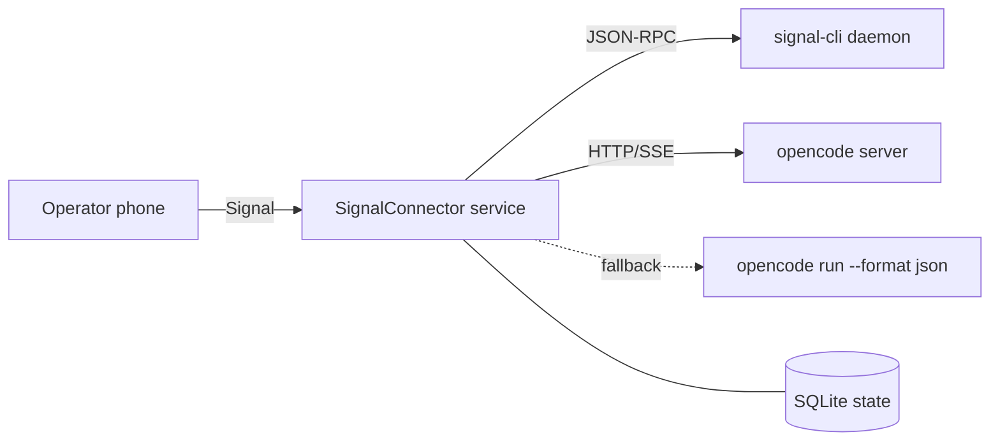

# SignalConnector — Architecture Spine

Consistency contract for the units built independently across epics. Stack, tree, and data
shapes below are **seed** (true at cold start, owned by code once it exists); the **AD-n** rules
are binding.

## Paradigm

**Ports & adapters (hexagonal), event-driven core.** A dependency-free domain core (`router`,
`tasks`, `progress`) sits between two driven ports — `SignalPort` and `AgentPort` — each with a
concrete adapter. Nothing in the core imports a concrete adapter.

## Context



## Decisions

### AD-1 — Ports & adapters, core has no I/O
**Binds**: every module boundary. **Prevents**: core logic coupled to Signal/opencode specifics.
**Rule**: `core/` must not import `adapters/`. It depends only on the `SignalPort` and
`AgentPort` interfaces and on plain domain types.

### AD-2 — Node/TypeScript, ESM, single process
**Binds**: language, module system, process model. **Prevents**: mixed runtimes and multi-process
state races. **Rule**: TypeScript compiled to ESM, Node ≥ 20, one long-lived process. No worker
threads for v1.

### AD-3 — SQLite is the single source of runtime state
**Binds**: state ownership. **Prevents**: two owners of a session/task record.
**Rule**: all mutable runtime state lives in one SQLite DB via a single `store` module. No
in-memory state that is not reconstructable from the DB after restart.

### AD-4 — Signal transport is signal-cli JSON-RPC over a managed daemon
**Binds**: the Signal boundary. **Prevents**: divergent transport assumptions.
**Rule**: the service owns/spawns `signal-cli daemon --http` and talks JSON-RPC. No direct
libsignal, no signald. Channel is restricted to one configured identifier.

### AD-5 — Agent boundary is `AgentAdapter`; opencode is the first adapter
**Binds**: the agent boundary. **Prevents**: per-agent branching leaking into the core.
**Rule**: core calls only `AgentAdapter` (`startTask`, `subscribe`, `answerPermission`,
`abort`, `newSession`). opencode-specific details stay in `adapters/agent/opencode`.

### AD-6 — One session per project; ids are opaque strings
**Binds**: session identity across core, store, and adapters. **Prevents**: incompatible session
keying. **Rule**: a project has a stable `projectId`; its current agent session id is an opaque
string stored in `sessions(projectId, sessionId)`. Core never parses an id.

### AD-7 — Every outbound Signal message goes through one sender with a rate limit and an edit handle
**Binds**: all outbound messaging. **Prevents**: duplicate sends and rate-limit bans.
**Rule**: only `SignalPort.send`/`edit` emit messages; the sender enforces the outbound rate limit
and records the returned timestamp as the edit handle.

### AD-8 — Permissions: forward `ask`, auto-allow safe, remember `always` per session
**Binds**: approval behavior. **Prevents**: agents blocked silently or over-approving.
**Rule**: the adapter classifies a permission as safe/ask; safe is auto-allowed, ask is forwarded;
`always` is persisted per `(projectId, tool)` for the session lifetime.

### AD-9 — Config vs secrets split
**Binds**: configuration storage. **Prevents**: secrets committed or logged.
**Rule**: non-secret config in `%APPDATA%/SignalConnector/config.toml`; secrets only via the
`secrets` module backed by Windows Credential Manager. No secret ever appears in a log line.

## Seed (owned by code once it exists)

```
src/
  core/            router, tasks, progress, ports (interfaces), domain types
  adapters/
    signal/        signal-cli JSON-RPC client, daemon manager, channel
    agent/opencode server client + CLI fallback
  store/           sqlite schema + repositories
  config/          config loader, secrets
  platform/        windows service/tray (later)
  index.ts         composition root (wires adapters into core)
```

Stack: TypeScript, ESM, Node ≥ 20; `better-sqlite3`; `undici`/`fetch` for HTTP; SSE for events;
`keytar`-class secret access; `vitest` for tests; `zod` for config/validation.

## Inherited Invariants

None (top-level initiative).

## Deferred

- Windows Service + Tauri tray packaging (later stage).
- Dedicated bot-number/group channel (channel layer allows it).
- Additional agent adapters (Claude Code, Codex).
- Stage 2 free-form steering semantics beyond a single follow-up prompt.
