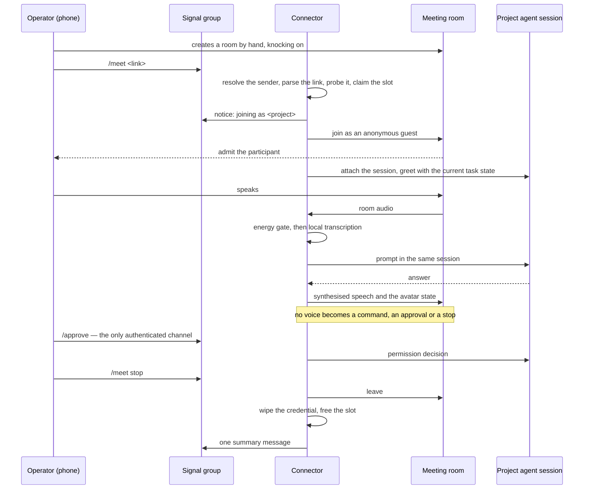

# Meeting flow

Companion to `spec-avatar-meeting.md`: the commands, the gate that decides whether a
paste is honoured, the sequence, what happens when a step fails, and the budgets.

## Commands, in a project's Signal group

| Command | Effect |
|---|---|
| `/meet <link>` | Accept the link for this project, join the room as the avatar. |
| `/meet stop` | Leave the room, wipe the credential, free the slot. |

There is no bare `/meet` and no configured room: the link the operator pastes *is* the
summon and the authorisation. One meeting at a time, whichever project asks. The group is
the record, so the notice, the refusals and the summary are posted there and nowhere else.

## The gate

A paste is honoured only when all of these hold; each failure has its own named refusal,
decided **before** anything joins.

| Check | Accepts | Refuses as |
|---|---|---|
| Sender | the configured identity for this project, resolved as (source path, sender): on the sync path the sender is the channel and counts as the operator's own linked device; on the data path it matches the number or ACI | not authorised (a different answer from unknown) |
| Shape | `https`, a canonical room link for an allow-listed provider host, alive by a pre-join probe | malformed link, foreign provider, room ended |
| Slot | nothing else open | already running under `<project>`, started `<time>` |

The claim *is* the write: validation and the single-meeting claim are one store write,
committed before any browser opens.

The claim keys on the open meeting, not on the URL, so pasting the same link twice is one
paste and one refusal. A room carries no project identity: which project the meeting
belongs to is decided by the channel the link arrived in.

## The sequence

## Failure modes

| Situation | Behaviour |
|---|---|
| No link, malformed link, foreign provider | Named refusal before anything joins. |
| Link from another sender, or from a group member | Named "not authorised" refusal; no silent drop, and the refusal never quotes the link. |
| Room already ended | Named refusal; the slot is never claimed. |
| Another meeting is open | Refusal naming the holding project and when it started. |
| Nobody admits the avatar | Leave after the admit budget and post "not admitted". |
| The room goes silent while admitted | The deaf alarm (see the kernel's CAP-8) posts in the group by the next poll; presence is reported as someone here, nobody visible or cannot tell. |
| The provider changes its join UI | Leave, post that the join needs a look, and keep the text loop working. |
| A permission is requested | Announced aloud and in the group; the decision is typed in Signal. |
| The operator leaves, or `/meet stop` | Leave, wipe the credential, free the slot, post one summary. A task still running keeps its row so its summary still lands. |
| Any declared guard fails | It posts in the group or raises a health signal. A guard that can fail quietly is a habit, not a guard. |
| A restart or a browser death mid-meeting | No rejoin in this slice: the credential is wiped, the slot is freed, the group is told. |

## Budgets

| Step | Budget |
|---|---|
| Refusal or notice after the paste | 2 s |
| Avatar visible in the room | 30 s (includes the operator admitting it) |
| Session attached and greeting | 5 s after admission |
| Spoken acknowledgement of a question | 2 s |
| Progress spoken while a task runs | At the milestones Signal already receives |
| Silence alarm while admitted | One poll (5 s of no remote audio and no track change) |
| Leave after stop | 5 s |
