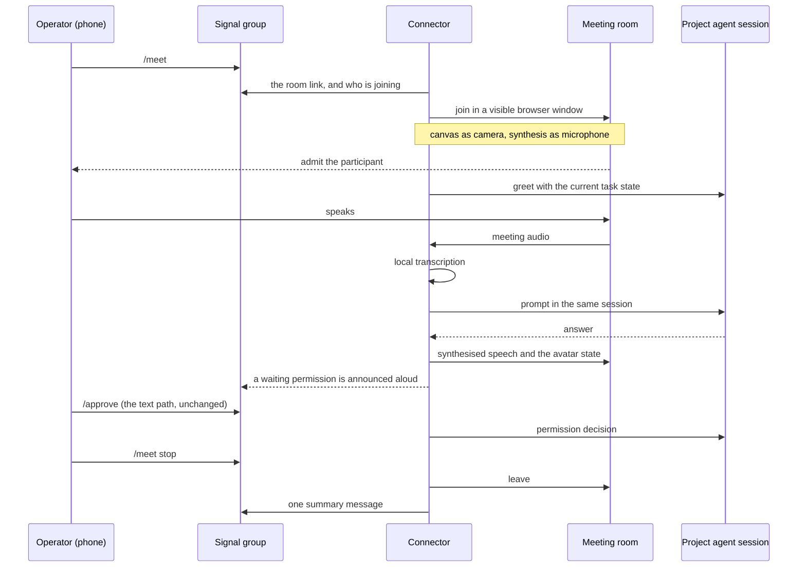
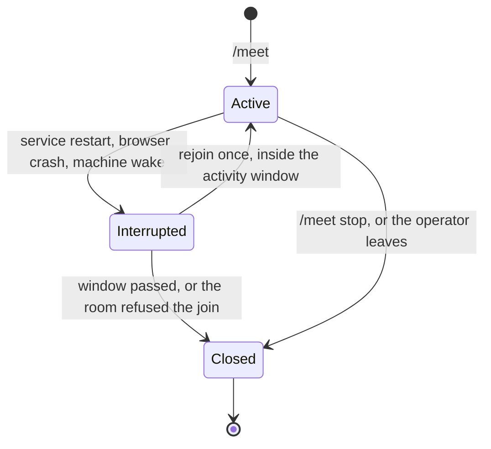

# Meeting flow

Companion to `spec-avatar-meeting.md`. The commands, the room, the end-to-end sequence,
what happens when a step fails, and the budgets.

## Commands, in a project's Signal group

| Command | Effect |
|---|---|
| `/meet` | Post the room link and join as this project's avatar. |
| `/meet stop` | Leave the room and free the slot. |
| `/meet <link>` | Join a different room once, without changing the configuration. |

`/meet` is a command, never a task: plain text in the group stays a prompt, exactly as
today. One meeting at a time, whichever project asks. The group is the record, so the
link, the join status and the outcome are posted there and nowhere else.

## The room

The room is configuration, not something the connector makes: `meet.room` in
`config.toml` holds the link, created once by the operator by hand. That is what keeps
this spec free of Google credentials, Cloud projects and API scopes — joining a room
needs none of them, so the rejoin path works with no authentication at all. The nearest
alternative, a room created per request, would need OAuth and a client secret for a
feature nobody asked for twice.

The avatar is named after the project, so the participant list says who is talking. A
per-project picture is not possible: the room takes it from the account that joins.

## Sequence

## Interruption

The meeting lives in the store (project, room, started at, last activity), because the
runtime rule is that state must be rebuildable from the database. On startup, or when
the browser window dies, the connector rejoins once if the meeting was active within
thirty minutes, says so in the group, and carries on. The conversation is not resumed
mid-sentence: the avatar returns and listens.

## Lifecycle and failure modes

| Situation | Behaviour |
|---|---|
| No room configured | Refuse and say which configuration key is missing. |
| A meeting is already running | Refuse, naming the project that holds it and when it started. |
| Nobody admits the avatar | Wait for the admit budget, then leave and report "not admitted" in the group. |
| The room no longer exists | Report it, free the slot, and wait for a `/meet <link>` or a configuration change. |
| The provider changes its join UI | The join fails: leave, report that the join needs a look, and keep the text loop working. |
| Service restart, browser crash, machine wake | Rejoin once inside the activity window (CAP-7). |
| Window passed while nobody was there | Stay closed, and say so in the group. |
| The operator leaves the room | Treated as `/meet stop`: leave, free the slot, post the summary. |
| A permission is requested | Announced aloud and in the group; the decision is typed in Signal (text-only, see the kernel). |

## Budgets

| Step | Budget |
|---|---|
| Link posted after `/meet` | 2 s (it comes from configuration) |
| Avatar visible in the room | 30 s (includes the operator admitting it) |
| Back in the room after an interruption | 60 s |
| Greeting once connected | 5 s |
| Spoken acknowledgement of a question | 2 s |
| Progress spoken while a task runs | At the milestones Signal already receives |
| Leave after stop | 5 s |
| Activity window for a rejoin | 30 min since the last activity |
