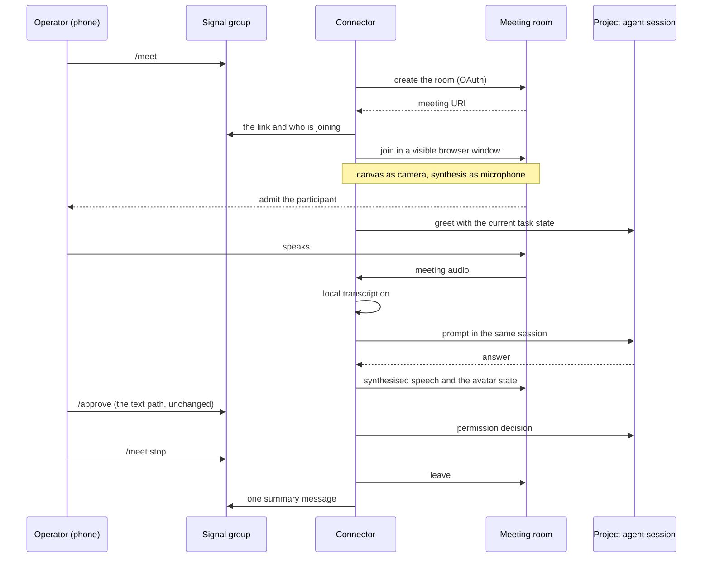

# Meeting flow

Companion to `spec-avatar-meeting.md`. The commands, how the room comes to exist, the
end-to-end sequence, and what happens when a step fails.

## Commands, in a project's Signal group

| Command | Effect |
|---|---|
| `/meet` | Create a room for this project, post the link, join as the avatar. |
| `/meet stop` | Leave the room and release the project. |
| `/meet <link>` | Join an existing room instead of creating one (the fixed-room fallback). |

`/meet` is a command, never a task: plain text in the group stays a prompt, exactly as
today. One meeting per project. The group is the record, so the link, the join status
and the outcome are posted there and nowhere else.

## How the room comes to exist

Google Meet is the platform because it costs nothing to reach: no API key, no marketplace
app, no fee. The nearest alternative, Zoom, reaches the same place only through a Meeting
SDK app plus a native SDK. Other meeting platforms (Teams, Meet-clones) were not
considered here.

| Route | Cost | Trade-off |
|---|---|---|
| Meet API `spaces.create` with OAuth — **recommended** | A Google Cloud project, one consent, a refresh token in the secrets store | A real meeting URI, no calendar entry, one new secret |
| Calendar event with `conferenceData` | The same OAuth plus a calendar scope | Also creates a calendar entry nobody asked for |
| The driven browser opens the new-room page and reads the link | No OAuth (it reuses the browser that joins anyway) | Fragile against Google UI changes; needs a logged-in profile |
| One fixed personal room from config | Nothing | Cannot produce a fresh link per request; fallback when credentials are absent |

## Sequence

## Lifecycle and failure modes

| Situation | Behaviour |
|---|---|
| No Google credentials configured | Post the fixed-room link if one is configured, otherwise say what is missing and how to configure it. |
| Nobody admits the avatar | Wait for the admit budget, then leave and report "not admitted" in the group. |
| The room cannot be created (quota, auth) | No link is posted; the group gets the reason. |
| Google changes its join UI | The join step fails: leave, report that the join needs a manual look, and keep the text loop working. |
| A second `/meet` while one runs | Refused: one meeting per project, with the running meeting's start time. |
| The operator leaves the room | Treated as `/meet stop`: leave, free the project, post the summary. |
| The connector restarts mid-meeting | Best effort: the room is left, the group is told, and the project is free again. |
| The agent asks a permission during the meeting | Asked in the group as today (spoken approvals are an open question). |

## Budgets

| Step | Budget |
|---|---|
| Link posted after `/meet` | 10 s |
| Avatar visible in the room | 30 s (includes the operator admitting it) |
| Greeting once connected | 5 s |
| Spoken acknowledgement of a question | 2 s |
| Progress spoken while a task runs | At the milestones Signal already receives |
| Leave after stop | 5 s |
